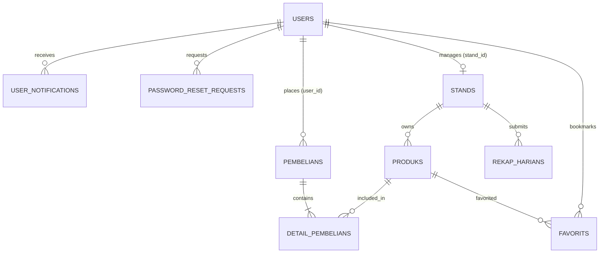

# PRODUCT REQUIREMENT DOCUMENT (PRD)
# SISTEM KANTIN DIGITAL SMKN 20 JAKARTA

---

| **Atribut Proyek**      | **Detail Informasi**                                                          |
| :---------------------- | :---------------------------------------------------------------------------- |
| **Nama Produk**         | **Kantin Digital SMKN 20 Jakarta**                                            |
| **Kategori Aplikasi**   | Web-Based Multi-Vendor School Canteen & Order Management System               |
| **Institusi**           | SMK Negeri 20 Jakarta                                                         |
| **Target Pengguna**     | Administrator Kantin, 8 Penjaga Stand Jurusan, Siswa / Guru (Pembeli)          |
| **Status Dokumen**      | Versi 1.0 (Final Architecture & Specification)                                |
| **Tech Stack Utama**    | PHP 8.2+, Laravel 11, MySQL, Tailwind CSS, Brevo API / SMTP, Railway Cloud     |
| **Tanggal Terbit**      | 10 November 2026                                                              |

---

## DAFTAR ISI
1. [Ringkasan Eksekutif & Tujuan Proyek](#1-ringkasan-eksekutif--tujuan-proyek)
2. [Arsitektur & Analisis Pilihan Teknologi (Tech Stack Rationale)](#2-arsitektur--analisis-pilihan-teknologi-tech-stack-rationale)
   - [2.1 Komposisi Teknologi Utama](#21-komposisi-teknologi-utama)
   - [2.2 Alasan Pemilihan Bahasa Pemrograman & Framework](#22-alasan-pemilihan-bahasa-pemrograman--framework)
   - [2.3 Alasan Pemilihan XAMPP (Local Development)](#23-alasan-pemilihan-xampp-local-development)
   - [2.4 Alasan Pemilihan Cloud Hosting Railway](#24-alasan-pemilihan-cloud-hosting-railway)
   - [2.5 Alasan Pemilihan Email Gateway Brevo API / SMTP](#25-alasan-pemilihan-email-gateway-brevo-api--smtp)
   - [2.6 Tabel Komparasi Kelebihan & Kekurangan Teknologi](#26-tabel-komparasi-kelebihan--kekurangan-teknologi)
3. [Hak Akses & Spesifikasi Fitur Berdasarkan Role](#3-hak-akses--spesifikasi-fitur-berdasarkan-role)
   - [3.1 Role Pembeli / Siswa](#31-role-pembeli--siswa)
   - [3.2 Role Penjaga Stand (8 Akun Terkoneksi)](#32-role-penjaga-stand-8-akun-terkoneksi)
   - [3.3 Role Administrator Sekolah](#33-role-administrator-sekolah)
4. [Struktur Basis Data (Database Schema & Dictionary)](#4-struktur-basis-data-database-schema--dictionary)
   - [4.1 Diagram Hubungan Entitas (ERD)](#41-diagram-hubungan-entitas-erd)
   - [4.2 Spesifikasi Tabel Database](#42-spesifikasi-tabel-database)
5. [Alur Kerja Sistem (User Flow & System Workflow)](#5-alur-kerja-sistem-user-flow--system-workflow)
   - [5.1 Alur Pemesanan & Pembayaran (User Flow)](#51-alur-pemesanan--pembayaran-user-flow)
   - [5.2 Alur Pemrosesan Pesanan oleh Penjaga Stand](#52-alur-pemrosesan-pesanan-oleh-penjaga-stand)
   - [5.3 Alur Pembatalan Pesanan & Koreksi Pendapatan](#53-alur-pembatalan-pesanan--koreksi-pendapatan)
   - [5.4 Alur Reset Password via Verifikasi Admin](#54-alur-reset-password-via-verifikasi-admin)
   - [5.5 Alur Rekapitulasi Keuangan Harian (Daily Report)](#55-alur-rekapitulasi-keuangan-harian-daily-report)
6. [Fitur Unggulan Spesifik](#6-fitur-unggulan-spesifik)
   - [6.1 Bukti Pembayaran QRIS & Lightbox Popup](#61-bukti-pembayaran-qris--lightbox-popup)
   - [6.2 Logika Akumulasi & Rollback Pendapatan](#62-logika-akumulasi--rollback-pendapatan)
   - [6.3 Modul Rekap Harian Interaktif](#63-modul-rekap-harian-interaktif)
   - [6.4 Kalkulator Kasir Standar](#64-kalkulator-kasir-standar)
   - [6.5 Mobile-First UI & Hidden App-like Scrollbars](#65-mobile-first-ui--hidden-app-like-scrollbars)
7. [Aspek Keamanan, Kinerja, & Non-Functional Requirements](#7-aspek-keamanan-kinerja--non-functional-requirements)
8. [Panduan Deployment ke Railway Cloud](#8-panduan-deployment-ke-railway-cloud)

---

## 1. RINGKASAN EKSEKUTIF & TUJUAN PROYEK

### 1.1 Latar Belakang
Kantin konvensional di lingkungan sekolah, khususnya di **SMK Negeri 20 Jakarta**, sering kali menghadapi sejumlah kendala klasik operasional:
1. **Penumpukan Antrean Fisik**: Waktu istirahat siswa yang terbatas (sekitar 30–45 menit) habis terbuang hanya untuk mengantre di depan stand makanan.
2. **Keterbatasan Informasi Menu & Stok**: Siswa sering kali baru mengetahui bahwa makanan favorit mereka telah habis setelah tiba di depan kasir stand.
3. **Pencatatan Keuangan Manual & Rentan Selisih**: Setiap penjaga stand mencatat pesanan menggunakan kertas nota atau buku kas manual, yang rentan hilang, rusak, atau salah hitung saat rekapitulasi harian.
4. **Verifikasi Pembayaran Digital**: Penggunaan QRIS statis tanpa sistem pencocokan bukti transfer kerap menimbulkan kebingungan bagi penjaga stand saat memastikan pembayaran siswa telah berhasil masuk.

### 1.2 Visi & Tujuan Produk
Aplikasi **Kantin Digital SMKN 20 Jakarta** hadir sebagai solusi multi-vendor berbasis web modern untuk mendigitalkan seluruh siklus pemesanan, pembayaran, hingga pelaporan keuangan di kantin sekolah.

**Tujuan Utama:**
- Memungkinkan siswa memesan makanan secara cepat dari mana saja (kelas/lab) melalui smartphone.
- Menyediakan alur status pesanan yang jelas: `Pending` → `Diproses` → `Dapat Diambil` → `Selesai` (atau `Dibatalkan`).
- Memberikan dashboard operasional terisolasi bagi **8 Stand Jurusan/Kantin**.
- Mengotomatiskan akumulasi pendapatan serta pencatatan **Rekap Harian** berbasis database yang presisi layaknya formulir digital profesional.
- Menyediakan panel kendali terpusat bagi Administrator Sekolah untuk mengawasi perputaran ekonomi kantin.

### 1.3 Target Pengguna
Sistem dirancang dengan pemisahan hak akses (*Role-Based Access Control* / RBAC):
1. **Administrator Sekolah (Super Admin)**: Pengelola sistem kantin, verifikator reset password, dan pengawas seluruh stand.
2. **Penjaga Stand (8 Akun Khusus Stand Jurusan)**: Operator stan yang memasak, memproses pesanan, memverifikasi bukti bayar, dan menyusun laporan harian.
3. **Pembeli (Siswa / Guru / Tenaga Pendidik)**: Pengguna akhir yang memilih menu, checkout, mengunggah bukti QRIS, dan menerima notifikasi pesanan.

---

## 2. ARSITEKTUR & ANALISIS PILIHAN TEKNOLOGI (TECH STACK RATIONALE)

### 2.1 Komposisi Teknologi Utama
```
+-----------------------------------------------------------------+
|                   FRONTEND PRESENTATION LAYER                   |
|   Tailwind CSS (Utility Classes) + FontAwesome 6 + Vanilla JS   |
|            Google Fonts (Poppins) + Blade Templating            |
+-----------------------------------------------------------------+
                                |
+-----------------------------------------------------------------+
|                    APPLICATION / BACKEND LAYER                  |
|          PHP 8.2+ Runtime | Laravel 11.x Framework (MVC)       |
|    - Routing, Middleware, Eloquent ORM, Session Manager         |
|    - Brevo API / SMTP Mailer (Email Reset Password)             |
|    - Storage Disk Link (Upload Gambar Produk & Bukti QRIS)      |
+-----------------------------------------------------------------+
                                |
+-----------------------------------------------------------------+
|                     PERSISTENCE / DATA LAYER                    |
|             MySQL 8.0+ / MariaDB 10.4+ (InnoDB Engine)          |
|                 Normalized Relational Tables (ACID)             |
+-----------------------------------------------------------------+
                                |
+-----------------------------------------------------------------+
|                  INFRASTRUCTURE & HOSTING LAYER                 |
| Local: XAMPP (Apache 2.4, MariaDB) on Windows Development       |
| Production: Railway Cloud (PaaS) with Automated Git Deployments |
+-----------------------------------------------------------------+
```

---

### 2.2 Alasan Pemilihan Bahasa Pemrograman & Framework

#### 1. Bahasa Pemrograman: PHP 8.2+
* **Alasan Pemilihan**:
  PHP adalah bahasa standar yang diajarkan pada kurikulum SMK jurusan Rekayasa Perangkat Lunak (RPL). Versi PHP 8.2 menghadirkan performa tinggi berkat mesin *JIT (Just-In-Time) compiler*, penulisan *typed properties*, *read-only classes*, serta *match expressions* yang membuat kode backend sangat aman, ringkas, dan mudah dipahami siswa maupun penguji.
* **Kelebihan**:
  - Dukungan dokumentasi dan komunitas terluas di dunia web development.
  - Sangat mudah di-host di mana saja (dari server lokal Apache hingga container Docker cloud).
  - Ekosistem paket dependensi Composer yang sangat matang.
* **Kekurangan**:
  - Konkurensi bawaan bersifat *synchronous per-request* (bukan *event-driven native* seperti Node.js/Go), namun hal ini sangat memadai dan stabil untuk volume lalu lintas kantin sekolah (ratusan transaksi bersamaan).

#### 2. Framework Backend: Laravel 11
* **Alasan Pemilihan**:
  Laravel adalah framework PHP nomor satu dunia dengan filosofi *convention over configuration* yang mengutamakan keamanan dan kerapian arsitektur MVC (*Model-View-Controller*).
* **Kelebihan**:
  - **Eloquent ORM**: Memudahkan query database yang kompleks (relasi antar stand, produk, pesanan, dan rekap) tanpa harus menulis query SQL mentah yang rawan bug.
  - **Keamanan Terintegrasi**: Memiliki proteksi bawaan terhadap serangan web terpopuler (CSRF Token pada setiap form POST, sanitasi parameter PDO untuk mencegah SQL Injection, serta hashing password menggunakan algoritma Bcrypt/Argon2).
  - **Blade Templating Engine**: Memisahkan logika backend dan antarmuka dengan sangat rapi, mendukung *layout inheritance*, dan tidak membebani kompilasi seperti SPA (*Single Page Application*).
* **Kekurangan**:
  - Ukuran footprint framework relatif lebih berat dibanding micro-framework (seperti Lumen/Slim), namun fitur bawaannya (auth, validation, migration) memangkas waktu pengerjaan proyek hingga 70%.

#### 3. Styling & Desain: Tailwind CSS & CDN Modern
* **Alasan Pemilihan**:
  Menggunakan utility-first Tailwind CSS memungkinkan perancangan UI bertema modern (warna *slate*, *emerald*, *indigo*, gradient elegan, dan efek *glassmorphism*) tanpa repot menulis ratusan baris file CSS kustom terpisah.
* **Kelebihan**:
  - Tampilan sangat responsif terhadap breakpoint mobile (`sm:`, `md:`, `lg:`).
  - Konsistensi spasi, warna, dan tipografi di seluruh halaman web.
* **Kekurangan**:
  - Nama class pada file HTML terlihat panjang (*utility classes*), namun mudah dibaca langsung maksud visualnya.

---

### 2.3 Alasan Pemilihan XAMPP (Local Development)
* **Mengapa Menggunakan XAMPP?**
  1. **Kemudahan Kurikulum & Lingkungan Lab Sekolah**: Komputer laboratorium SMKN 20 Jakarta berbasis sistem operasi Windows. XAMPP menyatukan web server Apache, PHP, dan database MySQL dalam satu kontrol panel yang mudah dinyalakan hanya dengan menekan tombol *Start*.
  2. **Zero-Configuration Local Database**: Tidak memerlukan instalasi container Docker yang memakan RAM besar pada laptop siswa atau komputer sekolah.
  3. **phpMyAdmin Terintegrasi**: Memudahkan siswa dan guru memantau tabel database fisik secara visual.
* **Kelebihan XAMPP**:
  - Sangat ringan, gratis, dan tidak membutuhkan koneksi internet saat mengembangkan aplikasi di kelas.
* **Kekurangan XAMPP**:
  - Bukan lingkungan *production-ready*. Konfigurasi Apache di Windows berbeda dengan Linux server, sehingga sebelum deploy cloud perlu dipastikan ekstensi PHP (seperti `pdo_mysql`, `mbstring`, `fileinfo`) cocok.

---

### 2.4 Alasan Pemilihan Cloud Hosting Railway
* **Mengapa Menggunakan Railway?**
  Aplikasi ini dipersiapkan untuk dapat diakses secara nyata oleh siswa dari smartphone mereka melalui internet sekolah. Railway dipilih sebagai platform cloud hosting (*PaaS* - Platform as a Service).
* **Kelebihan Railway**:
  1. **Continuous Deployment via GitHub**: Setiap kali source code di-push ke GitHub, Railway secara otomatis membangun (*build*) aplikasi Laravel dan menjalankan migrasi database.
  2. **Managed Cloud MySQL**: Railway menyediakan instance database MySQL cloud terisolasi dengan konektivitas SSL, backup otomatis, dan kestabilan 99.9%.
  3. **Manajemen Environment Variables (.env)**: Kredensial rahasia (kunci database, password mailer, app key) disimpan dengan enkripsi di dashboard cloud tanpa perlu masuk ke repositori git.
* **Kekurangan Railway**:
  - Menggunakan sistem kuota berbasis pemakaian (*usage-based*), sehingga perlu manajemen resource (misal: mematikan container staging yang tidak terpakai).

---

### 2.5 Alasan Pemilihan Email Gateway Brevo API / SMTP
* **Mengapa Menggunakan Brevo (Sendinblue)?**
  Ketika aplikasi berada di server cloud, fungsi `mail()` bawaan PHP sering kali diblokir oleh penyedia hosting atau email yang dikirim langsung masuk ke folder spam.
* **Kelebihan Brevo API / SMTP**:
  1. **Tingkat Keterkiriman Tinggi (*High Deliverability*)**: Brevo memiliki reputasi server IP yang bersih sehingga email verifikasi akun atau reset password langsung sampai di Inbox Gmail penerima.
  2. **Dukungan Protokol SMTP Standar**: Terhubung secara *native* dengan konfigurasi `config/mail.php` Laravel hanya dengan memasukkan Host, Port 587, Username, dan API Key sebagai password.
  3. **Gratis 300 Email per Hari**: Sangat mencukupi untuk kebutuhan notifikasi kantin sekolah tanpa biaya berlangganan.
* **Kekurangan Brevo**:
  - Membutuhkan verifikasi domain pengirim (SPF/DKIM) jika ingin menggunakan nama domain custom sekolah.

---

### 2.6 Tabel Komparasi Kelebihan & Kekurangan Teknologi

| Komponen Teknologi | Fungsi Utama | Kelebihan | Kekurangan |
| :--- | :--- | :--- | :--- |
| **PHP 8.2** | Bahasa Backend | Cepat, modern, didukung penuh kurikulum SMK, dokumentasi melimpah. | Eksekusi request berbasis thread sinkron standar. |
| **Laravel 11** | Full-Stack Framework | Fitur keamanan lengkap (CSRF, Auth, ORM), arsitektur bersih, maintenance mudah. | Membutuhkan pemahaman struktur MVC & artisan CLI. |
| **MySQL (InnoDB)** | Relational Database | Relasi antar tabel kuat, transaksi ACID aman dari selisih uang kasir, stabil. | Membutuhkan optimasi index pada volume data jutaan baris. |
| **Tailwind CSS** | Frontend Styling | UI modern, responsif mobile, tanpa file CSS terpisah, produktivitas tinggi. | Atribut class HTML lebih panjang. |
| **XAMPP** | Lingkungan Lokal | Praktis di Windows lab sekolah, ada phpMyAdmin, hemat RAM. | Konfigurasi server lokal berbeda dengan server Linux cloud. |
| **Railway** | Cloud Hosting | Auto-deploy git, cloud MySQL aman, sertifikat HTTPS otomatis, domain gratis. | Kuota runtime bulanan gratis terbatas. |
| **Brevo API** | Email Gateway | Reputasi tinggi, anti-spam, kuota gratis 300 email/hari, setup mudah di Laravel. | Perlu verifikasi identitas pengirim saat registrasi. |

---

## 3. HAK AKSES & SPESIFIKASI FITUR BERDASARKAN ROLE

```
                              +--------------------+
                              |  PENGGUNA SISTEM   |
                              +--------------------+
                                        |
            +---------------------------+---------------------------+
            |                           |                           |
            v                           v                           v
   +------------------+       +-------------------+       +-------------------+
   |   ROLE PEMBELI   |       | ROLE PENJAGA (8)  |       |    ROLE ADMIN     |
   | (Siswa / Guru)   |       |  (Stand Jurusan)  |       | (Pengelola Kantin)|
   +------------------+       +-------------------+       +-------------------+
   | - Katalog Stand  |       | - Status Buka/Ttp |       | - Master 8 Stand  |
   | - Beli / Cart    |       | - Manajemen Menu  |       | - Master Produk   |
   | - Upload QRIS    |       | - Kelola Pesanan  |       | - Pantau Semua TRX|
   | - Lacak Status   |       | - Validasi QRIS   |       | - Verif Reset Pwd |
   | - Notifikasi InApp|      | - Rekap Harian    |       | - Rekap Keuangan  |
   | - Menu Favorit   |       | - Kalkulator Kasir|       | - Kalkulator Kasir|
   +------------------+       +-------------------+       +-------------------+
```

---

### 3.1 Role Pembeli / Siswa
Target pengguna adalah seluruh civitas akademika SMKN 20 Jakarta.

#### Fitur Utama Pembeli:
1. **Landing Page Interaktif (Mobile-First)**:
   - Menampilkan banner hero selamat datang, ulasan rating kantin, dan keunggulan kantin digital.
   - Navigasi responsif: pada handphone terdapat tombol *hamburger menu* yang dilengkapi opsi login/logout rapi.
   - Bebas visual bilah scroll (*hidden scrollbar*) untuk memberikan pengalaman seperti aplikasi mobile *native*.
2. **Katalog Stand & Menu Makanan**:
   - Menjelajahi menu dari 8 stand resmi jurusan.
   - Filter menu berdasarkan kategori: **Makanan**, **Minuman**, atau **Snack / Cemilan**.
   - Kolom pencarian produk *live search* berdasarkan nama makanan.
   - Menandai produk sebagai **Menu Favorit** (disimpan ke database tabel `favorits`).
3. **Pemesanan Fleksibel (2 Jalur)**:
   - **Checkout Cepat (Beli Sekarang)**: Membeli langsung 1 menu dengan modal AJAX popup tanpa memasukkan ke keranjang belanja terlebih dahulu.
   - **Keranjang Belanja (Cart System)**: Mengumpulkan beberapa menu dari satu atau beberapa stand sebelum menyelesaikan pembayaran serentak.
4. **Metode Pembayaran & Upload Bukti QRIS**:
   - Pilihan metode: **Tunai (Cash di tempat)** atau **QRIS**.
   - Jika memilih QRIS:
     * Sistem menampilkan QR Code resmi milik stand bersangkutan (atau QRIS umum kantin).
     * Terdapat tombol **Unduh QRIS** agar siswa dapat menyimpan QR ke galeri.
     * **Form Wajib Upload Bukti Transfer**: Siswa mengunggah screenshot bukti pembayaran (JPG/PNG/WebP, maks 5MB) dengan live image preview sebelum order dapat dikirim.
5. **Pelacakan Status Pesanan & Riwayat**:
   - Mengetahui status pesanan secara *real-time*:
     * `Pending`: Menunggu konfirmasi penjaga stand.
     * `Diproses`: Sedang dimasak / disiapkan oleh stand.
     * `Dapat Diambil`: Makanan sudah matang dan siswa dipersilakan menuju stand membawa kode transaksi.
     * `Selesai`: Siswa telah mengambil makanan.
     * `Dibatalkan`: Pesanan dibatalkan disertai alasan.
6. **Notifikasi In-App**:
   - Ikon lonceng di navbar dengan indikator angka merah unread badge.
   - Notifikasi otomatis masuk saat pesanan dibuat, diproses, dapat diambil, selesai, atau saat password berhasil diubah.
7. **Sistem Lupa Password Terverifikasi Admin**:
   - Siswa yang lupa password mengajukan permohonan ke admin (tanpa link email yang rentan gagal).
   - Setelah admin menyetujui, akun siswa dapat mereset password baru secara aman.

---

### 3.2 Role Penjaga Stand (8 Akun Terkoneksi)
Setiap akun penjaga stand terikat secara permanen pada 1 stand jurusan melalui kolom `stand_id` di database:

| No | Nama Stand Jurusan | Email Akun Penjaga | Pemilik / Penanggung Jawab |
| :-: | :--- | :--- | :--- |
| **1** | **Stand Rekayasa Perangkat Lunak** | `rekayasaperangkatlunak@kantin.id` | Pak Haji |
| **2** | **Stand Bisnis Digital** | `bisnisdigital@kantin.id` | Bu Siti |
| **3** | **Stand Management Perkantoran 1** | `managementperkantoran1@kantin.id` | Pak Budi |
| **4** | **Stand Management Perkantoran 2** | `managementperkantoran2@kantin.id` | Pak Ahmad |
| **5** | **Stand Akuntansi 1** | `akuntansi1@kantin.id` | Pak Rudi |
| **6** | **Stand Akuntansi 2** | `akuntansi2@kantin.id` | Bu Nur |
| **7** | **Stand Layanan Perbankan Syariah**| `layananperbankan@kantin.id` | Bu Ani |
| **8** | **Stand Bisnis Retail** | `bisnisretail@kantin.id` | Pak Doni |

#### Fitur Utama Penjaga Stand:
1. **Dashboard Operasional Khusus Stand**:
   - **Switch Status Buka / Tutup Stand**: Mengubah status stan kapan saja. Jika ditutup, menu stand tidak dapat dipesan siswa.
   - **Baris 1 (Kartu Produk & Keuangan)**: Total Produk, Produk Siap Dijual, Stok Habis / Perlu Diisi, dan Total Pendapatan Riil Stand.
   - **Baris 2 (Kartu Status Pesanan - 6 Status Lengkap)**:
     * `Total Pesanan`: Seluruh pesanan yang masuk ke stand ini.
     * `Pending`: Pesanan baru yang butuh persetujuan.
     * `Diproses`: Pesanan yang sedang dimasak/disiapkan.
     * `Dapat Diambil`: Pesanan yang telah siap diambil siswa.
     * `Selesai`: Pesanan yang sukses diserahkan.
     * `Dibatalkan`: Pesanan yang ditolak atau dibatalkan.
2. **Manajemen Produk Stand**:
   - Menambah hidangan baru (Nama, Deskripsi, Harga, Stok, Kategori: Makanan/Minuman/Snack).
   - Mengunggah foto produk lokal tersimpan di `storage/app/public/`.
   - Toggle ketersediaan hidangan (*Tersedia / Habis*).
3. **Pemrosesan Pesanan & Validasi Bukti Pembayaran**:
   - Mengubah status pesanan secara bertahap dari `Pending` → `Diproses` → `Dapat Diambil` → `Selesai`.
   - **Lightbox Popup Bukti QRIS**: Penjaga stand dapat mengeklik tombol *"Lihat Bukti Penuh"* untuk memeriksa screenshot pembayaran pelanggan di modal layar penuh sebelum mulai memasak.
4. **Logika Akumulasi Pendapatan Otomatis & Proteksi Koreksi**:
   - Pendapatan bertambah otomatis ke kas stand **hanya ketika status diubah menjadi Selesai**.
   - Jika pesanan dibatalkan sebelum selesai (masih pending/diproses), kas pendapatan **tidak terpengaruh**.
   - Jika pesanan yang *sudah terlanjur selesai* dibatalkan kembali oleh penjaga stand, sistem **secara otomatis memotong kembali total pendapatan** sebesar subtotal transaksi tersebut.
5. **Alat Bantu Kalkulator Standar**:
   - Tersedia di menu sidebar untuk mempermudah perhitungan kembalian tunai atau perhitungan modal belanja harian penjaga stand secara cepat tanpa keluar aplikasi.
6. **Modul Rekap Harian (Daily Report Form)**:
   - Formulir terstruktur pencatatan rekapitulasi harian (Senin s/d Jumat).
   - Tombol **Ambil Data Otomatis**: Menarik total omzet riil dan jumlah pesanan langsung dari sistem database hari tersebut.
   - Input manual format Rupiah dengan pemisah ribuan titik otomatis saat diketik.
   - Perhitungan otomatis laba kotor, modal operasional, dan **Keuntungan Bersih**.
   - Disimpan permanen di database tabel `rekap_harians` sebagai arsip audit sekolah.

---

### 3.3 Role Administrator Sekolah
Admin memiliki otoritas tertinggi untuk mengawasi seluruh aktivitas operasional 8 stand:

#### Fitur Utama Admin:
1. **Dashboard Monitoring Terpusat**:
   - Statistik global: Total Stand Terdaftar (8), Total Produk Seluruh Stand, Total Pesanan Sekolah, dan Akumulasi Seluruh Omzet Kantin.
   - 5 Kartu Status Global: `Pending`, `Diproses`, `Dapat Diambil`, `Selesai`, dan `Dibatalkan`.
   - Widget pesanan terbaru dan direktori stand aktif.
2. **Manajemen Stand (CRUD Stand)**:
   - Menambahkan stand baru, mengedit data pemilik, nomor WhatsApp stand, mengubah gambar banner stand, dan mengunggah QRIS masing-masing stand.
3. **Manajemen Produk Global**:
   - Memantau dan mengelola produk dari semua stand, memastikan foto dan harga makanan sesuai aturan sekolah.
4. **Pusat Kelola Pesanan Multi-Filter**:
   - Memfilter transaksi berdasarkan Stand Jurusan, Kategori Produk, Metode Pembayaran, atau Status Pesanan.
   - Melihat rincian pembeli, catatan pesanan, dan bukti transfer QRIS via Lightbox Modal.
5. **Manajemen Pengajuan Reset Password Siswa**:
   - Panel khusus untuk memverifikasi siswa yang lupa password.
   - Admin dapat menyetujui (*Approve*) atau menolak permohonan dengan 1 kali klik. Siswa yang disetujui akan langsung menerima notifikasi untuk mengganti password baru.
6. **Kalkulator & Laporan Keuangan Terpadu**:
   - Memantau rekapitulasi harian seluruh stand dan melakukan audit keuangan bulanan.
   - Fitur reset transaksi berkala (jika dibutuhkan pembukuan tahun ajaran baru).

---

## 4. STRUKTUR BASIS DATA (DATABASE SCHEMA & DICTIONARY)

### 4.1 Diagram Hubungan Entitas (ERD)



---

### 4.2 Spesifikasi Tabel Database

#### 1. Tabel `users`
Menyimpan kredensial otentikasi seluruh aktor sistem.

| Nama Kolom | Tipe Data | Keterangan / Constraint |
| :--- | :--- | :--- |
| `id` | BIGINT UNSIGNED (PK) | Auto increment identifier |
| `name` | VARCHAR(255) | Nama lengkap pengguna |
| `email` | VARCHAR(255) (UNIQUE) | Alamat email unik (login) |
| `password` | VARCHAR(255) | Hash password Bcrypt |
| `role` | ENUM('admin','penjaga','user') | Hak akses sistem (Default: `'user'`) |
| `stand_id` | BIGINT UNSIGNED (FK, Nullable) | Relasi ke `stands.id` (khusus role penjaga) |
| `google_id` | VARCHAR(255) (Nullable) | ID login OAuth Google (opsional) |
| `email_verified_at` | TIMESTAMP (Nullable) | Waktu verifikasi email |
| `remember_token` | VARCHAR(100) | Token sesi login otomatis |
| `created_at` / `updated_at` | TIMESTAMP | Waktu pembuatan & modifikasi |

---

#### 2. Tabel `stands`
Menyimpan profil 8 stand jurusan di kantin SMKN 20 Jakarta.

| Nama Kolom | Tipe Data | Keterangan / Constraint |
| :--- | :--- | :--- |
| `id` | BIGINT UNSIGNED (PK) | Primary key stand |
| `nama_stand` | VARCHAR(255) | Nama stand (contoh: Stand Bisnis Digital) |
| `deskripsi` | TEXT (Nullable) | Deskripsi spesialisasi kuliner stand |
| `gambar` | VARCHAR(255) (Nullable) | Path banner stand di `storage/` |
| `qris_gambar` | VARCHAR(255) (Nullable) | Path file gambar QR Code QRIS stand |
| `pemilik` | VARCHAR(255) (Nullable) | Nama penanggung jawab / guru / siswa |
| `no_telepon` | VARCHAR(50) (Nullable) | Nomor telepon/WhatsApp stand |
| `status_buka` | BOOLEAN | `true` = Buka, `false` = Tutup (Default: `true`) |
| `total_pendapatan` | DECIMAL(12, 2) | Akumulasi pendapatan riil dari pesanan selesai |
| `created_at` / `updated_at` | TIMESTAMP | Waktu pencatatan |

---

#### 3. Tabel `produks`
Katalog makanan, minuman, dan camilan yang dijual oleh setiap stand.

| Nama Kolom | Tipe Data | Keterangan / Constraint |
| :--- | :--- | :--- |
| `id` | BIGINT UNSIGNED (PK) | Primary key produk |
| `stand_id` | BIGINT UNSIGNED (FK) | Relasi ke `stands.id` (Cascade on delete) |
| `nama_produk` | VARCHAR(255) | Nama menu hidangan |
| `deskripsi` | TEXT (Nullable) | Komposisi atau keterangan porsi |
| `harga` | DECIMAL(10, 2) | Harga jual satuan (Rupiah) |
| `gambar` | VARCHAR(255) (Nullable) | Path gambar menu makanan |
| `kategori` | ENUM('Makanan','Minuman','Snack/Cemilan') | Klasifikasi jenis menu |
| `stock` | INT | Sisa kuantitas porsi tersedia |
| `tersedia` | BOOLEAN | Status ketersediaan aktif (`true`/`false`) |
| `created_at` / `updated_at` | TIMESTAMP | Waktu pembuatan & update |

---

#### 4. Tabel `pembelians` (Header Transaksi)
Menyimpan rincian faktur dan alur status pesanan.

| Nama Kolom | Tipe Data | Keterangan / Constraint |
| :--- | :--- | :--- |
| `id` | BIGINT UNSIGNED (PK) | Primary key transaksi |
| `user_id` | BIGINT UNSIGNED (FK, Nullable) | Relasi ke `users.id` pemesan |
| `kode_pembelian` | VARCHAR(50) (UNIQUE) | Format unik: `TRX + TahunBulanHari + Random` |
| `nama_pembeli` | VARCHAR(255) | Nama lengkap pemesan |
| `email` | VARCHAR(255) (Nullable) | Email pembeli |
| `no_telepon` | VARCHAR(50) (Nullable) | Nomor kontak pembeli |
| `alamat` | TEXT (Nullable) | Lokasi pengantaran / Nama Kelas (misal: XII RPL 1) |
| `total_harga` | DECIMAL(12, 2) | Total tagihan pesanan (Rupiah) |
| `status` | ENUM | `'pending'`,`'diproses'`,`'dapat_diambil'`,`'selesai'`,`'dibatalkan'` |
| `catatan` | TEXT (Nullable) | Catatan selera (contoh: "pedas sedang, tanpa timun") |
| `metode_pembayaran`| ENUM('tunai','qris') | Metode bayar yang dipilih |
| `bukti_pembayaran` | VARCHAR(255) (Nullable) | Path file screenshot bukti transfer QRIS |
| `created_at` / `updated_at` | TIMESTAMP | Waktu transaksi dibuat dan diupdate |

---

#### 5. Tabel `detail_pembelians` (Item Transaksi)
Menyimpan rincian produk yang dibeli per transaksi.

| Nama Kolom | Tipe Data | Keterangan / Constraint |
| :--- | :--- | :--- |
| `id` | BIGINT UNSIGNED (PK) | Primary key detail |
| `pembelian_id` | BIGINT UNSIGNED (FK) | Relasi ke `pembelians.id` (Cascade delete) |
| `produk_id` | BIGINT UNSIGNED (FK) | Relasi ke `produks.id` |
| `nama_produk` | VARCHAR(255) | Snapshot nama menu saat transaksi |
| `quantity` | INT | Jumlah porsi yang dipesan |
| `harga` | DECIMAL(10, 2) | Snapshot harga satuan saat transaksi |
| `subtotal` | DECIMAL(12, 2) | `quantity * harga` |
| `created_at` / `updated_at` | TIMESTAMP | Waktu pencatatan |

---

#### 6. Tabel `rekap_harians`
Mencatat pelaporan keuangan harian tiap stand layaknya formulir rekapitulasi permanen.

| Nama Kolom | Tipe Data | Keterangan / Constraint |
| :--- | :--- | :--- |
| `id` | BIGINT UNSIGNED (PK) | Primary key rekap |
| `stand_id` | BIGINT UNSIGNED (FK) | Relasi ke `stands.id` stand pelapor |
| `tanggal` | DATE | Tanggal rekapitulasi (YYYY-MM-DD) |
| `hari` | VARCHAR(20) | Nama hari kerja: 'Senin', 'Selasa', 'Rabu', 'Kamis', 'Jumat' |
| `total_pendapatan` | DECIMAL(12, 2) | Total omzet kotor hari tersebut |
| `total_keuntungan` | DECIMAL(12, 2) | Laba bersih setelah dikurangi modal bahan |
| `total_pesanan` | INT | Total kuantitas pesanan masuk |
| `pesanan_selesai` | INT | Jumlah pesanan yang sukses diselesaikan |
| `pesanan_dibatalkan`| INT | Jumlah pesanan yang dibatalkan |
| `catatan` | TEXT (Nullable) | Catatan operasional stan |
| `created_at` / `updated_at` | TIMESTAMP | Waktu perekaman rekapitulasi |

---

#### 7. Tabel Pendukung Lainnya:
- `user_notifications`: Menyimpan log notifikasi in-app siswa (`title`, `message`, `type`, `is_read`).
- `password_reset_requests`: Menyimpan pengajuan buka kunci password oleh siswa kepada admin (`user_id`, `email`, `status: pending/approved/rejected`).
- `favorits`: Menghubungkan `user_id` dengan `produk_id` yang disukai siswa.

---

## 5. ALUR KERJA SISTEM (USER FLOW & SYSTEM WORKFLOW)

### 5.1 Alur Pemesanan & Pembayaran (User Flow)
```
[ Siswa / Pembeli ]
        |
        v
1. Buka Web Kantin Digital -> Pilih Stand Jurusan
        |
        v
2. Pilih Menu Makanan/Minuman -> (Beli Cepat ATAU Tambah ke Keranjang)
        |
        v
3. Menuju Form Checkout -> Isi Data Diri & Kelas
        |
        +---> Pilih Metode: TUNAI (Bayar langsung di kasir kantin)
        |
        +---> Pilih Metode: QRIS
                 |
                 v
              Scan QR Code Stand / Unduh QRIS
                 |
                 v
              Transfer via E-Wallet / Mobile Banking
                 |
                 v
              Unggah Foto Bukti Transfer (Wajib)
        |
        v
4. Klik "Konfirmasi & Bayar Sekarang"
        |
        v
Sistem Mengurangi Stok Produk -> Menyimpan Bukti QRIS di Storage
        |
        v
Siswa Mendapatkan Kode TRX & Notifikasi: "Pesanan Berhasil Dibuat"
```

---

### 5.2 Alur Pemrosesan Pesanan oleh Penjaga Stand
```
[ Penjaga Stand ]
        |
        v
1. Login Akun Stand -> Buka Dashboard Stand
        |
        v
2. Masuk ke Menu "Pesanan Masuk" (Badge filter: Pending)
        |
        v
3. Klik Icon Detail (Tanda Mata):
   - Periksa data pemesan, kelas, catatan selera
   - Jika QRIS: Klik "Lihat Bukti Penuh" di Lightbox Modal untuk verifikasi
        |
        v
4. Ubah Status: "Pending" ---> "Diproses" (Stand mulai memasak)
        |
        v (Siswa menerima Notifikasi: Pesanan Sedang Diproses)
        |
5. Makanan Matang -> Ubah Status: "Diproses" ---> "Dapat Diambil"
        |
        v (Siswa menerima Notifikasi: Makanan Siap Diambil di Stand)
        |
6. Siswa datang menunjukkan Kode TRX -> Serahkan Makanan
        |
        v
7. Ubah Status: "Dapat Diambil" ---> "Selesai"
        |
        v
Sistem Otomatis Mengakumulasi Pendapatan Kas Stand ($stand->tambahPendapatan)
```

---

### 5.3 Alur Pembatalan Pesanan & Koreksi Pendapatan
```
                      [ Pesanan Ingin Dibatalkan ]
                                   |
         +-------------------------+-------------------------+
         |                                                   |
Status Awal: PENDING / DIPROSES / DAPAT DIAMBIL     Status Awal: SUDAH SELESAI
         |                                                   |
         v                                                   v
Diubah ke: "DIBATALKAN"                             Diubah ke: "DIBATALKAN"
         |                                                   |
Pesanan memang BELUM dihitung ke kas               Pesanan SEBELUMNYA SUDAH dihitung
         |                                                   |
         v                                                   v
Pendapatan Stand TETAP UTUH (Tidak Berubah)         Sistem OTOMATIS MEMOTONG Kas Stand
                                                    ($stand->kurangiPendapatan)
         |                                                   |
         +-------------------------+-------------------------+
                                   |
                                   v
             Notifikasi Pembatalan Terkirim ke Smartphone Siswa
```

---

### 5.4 Alur Reset Password via Verifikasi Admin
```
[ Siswa Lupa Password ]
         |
         v
1. Klik "Lupa Password" di halaman Login
         |
         v
2. Masukkan Alamat Email Akun Terdaftar -> Kirim Pengajuan
         |
         v
3. Sistem membuat tiket pengajuan di tabel `password_reset_requests` (Status: Pending)
         |
         v
[ Admin Kantin ]
         |
         v
4. Admin menerima alert notifikasi di Dashboard -> Buka menu "Reset Password"
         |
         v
5. Admin mengecek identitas siswa -> Klik tombol "Setujui" (Approved)
         |
         v
6. Siswa menerima konfirmasi persetujuan di web / notifikasi akun
         |
         v
7. Siswa memasukkan password baru -> Akun kembali aktif!
```

---

### 5.5 Alur Rekapitulasi Keuangan Harian (Daily Report)
```
[ Penjaga Stand (Sore Hari / Tutup Stand) ]
         |
         v
1. Masuk ke Menu "Rekap Harian" di Sidebar Stand
         |
         v
2. Pilih Hari (Senin / Selasa / Rabu / Kamis / Jumat) & Tanggal Hari Ini
         |
         v
3. Klik Tombol "Ambil Data Otomatis":
   - Sistem membaca database: Menghitung total omzet pesanan 'selesai'
   - Menghitung jumlah pesanan sukses dan dibatalkan hari tersebut
   - Mengisi kolom input secara instan
         |
         v
4. Penjaga Stand menginput Modal / Pengeluaran Belanja Bahan
         |
         v
5. Sistem secara otomatis menghitung Keuntungan Bersih (Laba Bersih)
         |
         v
6. Klik "Simpan Rekapitulasi" -> Tersimpan permanen di tabel `rekap_harians`
         |
         v
Admin Sekolah dapat memantau dan mencetak laporan harian seluruh 8 stand secara transparan
```

---

## 6. FITUR UNGGULAN SPESIFIK

### 6.1 Bukti Pembayaran QRIS & Lightbox Popup
- **Validasi Multi-Layer**: File wajib berekstensi gambar (`jpeg, png, jpg, webp`) dengan ukuran maksimal 5120 KB (5 MB).
- **Lightbox Popup Resolusi Penuh**: Admin dan Penjaga Stand tidak perlu berpindah halaman atau membuka tab baru yang mengganggu alur kerja kasir. Klik tombol *"Lihat Bukti Penuh"* akan memunculkan gambar transfer secara instan dalam modal berlatar gelap transparan (*backdrop blur*).

### 6.2 Logika Akumulasi & Rollback Pendapatan
- Mencegah manipulasi angka pendapatan kotor.
- Menggunakan atomic database operations (`increment` dan `decrement`) pada tabel `stands` guna mencegah *race condition* bila beberapa pesanan diselesaikan dalam detik yang sama.
- Sinkronisasi otomatis (*self-healing check*) di halaman Dashboard: total pendapatan selalu mencerminkan penjumlahan subtotal pesanan berstatus `'selesai'`.

### 6.3 Modul Rekap Harian Interaktif
- Format mata uang interaktif: Saat mengetik angka pada form rekap harian, JavaScript secara otomatis memformat angka dengan tanda titik ribuan (misal: `150.000`), dan secara cerdas menghapus titik saat disimpan ke basis data `DECIMAL`.
- Menyediakan riwayat log per tanggal untuk mencegah laporan ganda pada satu hari yang sama.

### 6.4 Kalkulator Kasir Standar
- Kalkulator numerik terintegrasi langsung di dalam panel Admin dan Penjaga Stand.
- Dirancang untuk perhitungan cepat kas kecil, pengembalian uang siswa saat membayar tunai, dan rekap selisih fisik uang di laci kasir.

### 6.5 Mobile-First UI & Hidden App-like Scrollbars
- Menggunakan aturan CSS:
  ```css
  html, body {
      -ms-overflow-style: none;  /* IE and Edge */
      scrollbar-width: none;     /* Firefox */
  }
  html::-webkit-scrollbar,
  body::-webkit-scrollbar {
      display: none;             /* Chrome, Safari, Opera */
      width: 0;
      height: 0;
  }
  ```
- Seluruh halaman pengguna (beranda, stand, checkout, profil) terasa seperti aplikasi mobile native Android/iOS yang halus saat digulir, sementara panel admin desktop tetap memiliki scrollbar standar agar nyaman di monitor komputer.

---

## 7. ASPEK KEAMANAN, KINERJA, & NON-FUNCTIONAL REQUIREMENTS

### 7.1 Keamanan Sistem (Security)
1. **Perlindungan Terhadap CSRF (Cross-Site Request Forgery)**:
   Setiap form `POST`, `PUT`, `PATCH`, dan `DELETE` diproteksi menggunakan directive `@csrf` dengan token terenkripsi.
2. **Pencegahan SQL Injection**:
   Seluruh query interaksi database menggunakan PDO Parameter Binding melalui Eloquent ORM Laravel.
3. **Penyimpanan Password Aman**:
   Password pengguna di-hash menggunakan algoritma **Bcrypt** dengan salt otomatis (tidak ada password yang disimpan dalam bentuk teks polos).
4. **Proteksi Middleware Otentikasi**:
   - `auth`: Memastikan hanya pengguna login yang dapat bertransaksi.
   - `admin`: Membatasi area `/admin/*` hanya untuk role `admin`.
   - `penjaga`: Membatasi area `/penjaga/*` dan memastikan penjaga hanya dapat melihat data stand yang terdaftar pada dirinya.
5. **Validasi File Upload**:
   File upload bukti transfer diperiksa tipe MIME dan ekstensinya di sisi server untuk mencegah eksekusi skrip berbahaya (*arbitrary file execution*).

### 7.2 Kinerja & Optimasi (Performance)
- **Asset Optimization**: Penggunaan Tailwind CDN dan icons FontAwesome CDN yang di-cache di browser klien.
- **Query Optimization**: Menggunakan *Eager Loading* (`with(['detailPembelians.produk.stand'])`) untuk menghindari problem query berulang (*N+1 Query Problem*).
- **Storage Symlink**: Berkas gambar diakses langsung melalui link publik web server tanpa membebani runtime PHP.

---

## 8. PANDUAN DEPLOYMENT KE RAILWAY CLOUD

Untuk mempublikasikan aplikasi ini ke server cloud Railway:

1. **Persiapan Repositori GitHub**:
   - Pastikan seluruh file proyek telah di-commit ke repositori GitHub.
   - File `.env` asli tidak boleh masuk ke repositori (`.gitignore`).
2. **Membuat Proyek di Railway**:
   - Buka [Railway.app](https://railway.app), buat proyek baru via *"Deploy from GitHub repo"*.
   - Tambahkan plugin database: **Railway MySQL**.
3. **Konfigurasi Environment Variables di Railway Dashboard**:
   ```ini
   APP_NAME="Kantin Digital SMKN 20 Jakarta"
   APP_ENV=production
   APP_DEBUG=false
   APP_URL=https://kantin-digital-anda.up.railway.app
   APP_KEY=base64:GENERATE_VIA_ARTISAN

   DB_CONNECTION=mysql
   DB_HOST=${{MySQL.MYSQLHOST}}
   DB_PORT=${{MySQL.MYSQLPORT}}
   DB_DATABASE=${{MySQL.MYSQLDATABASE}}
   DB_USERNAME=${{MySQL.MYSQLUSER}}
   DB_PASSWORD=${{MySQL.MYSQLPASSWORD}}

   MAIL_MAILER=smtp
   MAIL_HOST=smtp-relay.brevo.com
   MAIL_PORT=587
   MAIL_USERNAME=email_anda@gmail.com
   MAIL_PASSWORD=api_key_brevo_anda
   MAIL_ENCRYPTION=tls
   MAIL_FROM_ADDRESS="kantin@smkn20jakarta.sch.id"
   MAIL_FROM_NAME="Kantin Digital SMKN 20"
   ```
4. **Deploy Command & Migration**:
   - Railway secara otomatis mendeteksi project Laravel (Nixpacks).
   - Jalankan perintah awal:
     ```bash
     php artisan migrate --force
     php artisan db:seed --force
     php artisan storage:link
     ```
5. **Aplikasi Siap Digunakan**:
   Website Kantin Digital SMKN 20 Jakarta resmi aktif secara online dan siap digunakan oleh ratusan siswa serta 8 penjaga stand!

---

*Dokumen ini disusun sebagai panduan teknis resmi, acuan arsitektur sistem, dan standar operasional pengembangan aplikasi Kantin Digital SMKN 20 Jakarta.*

